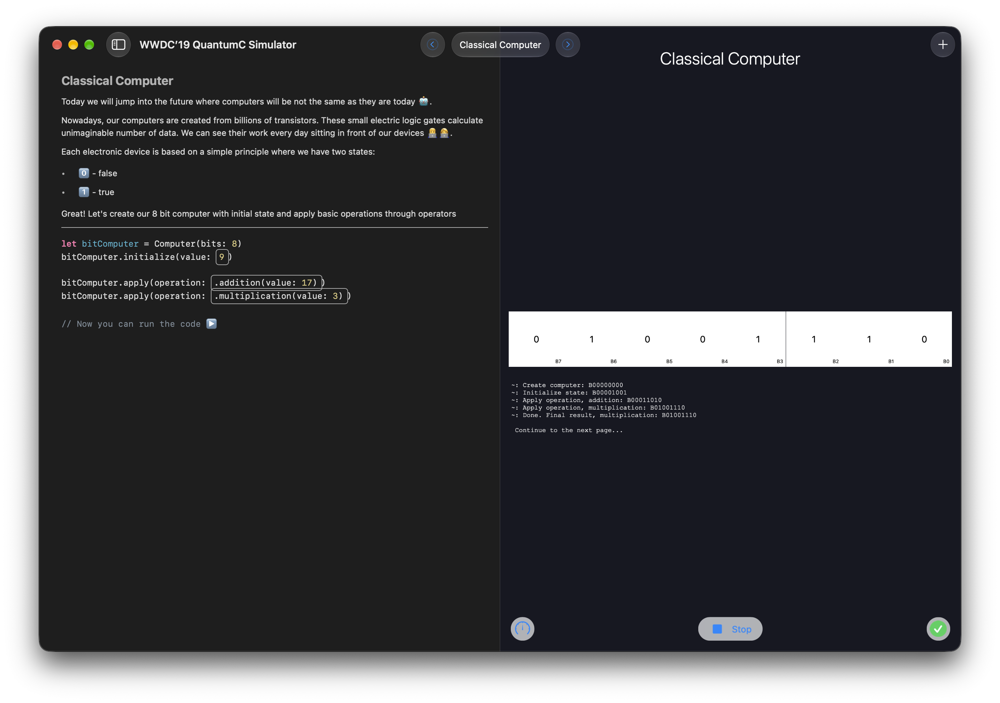
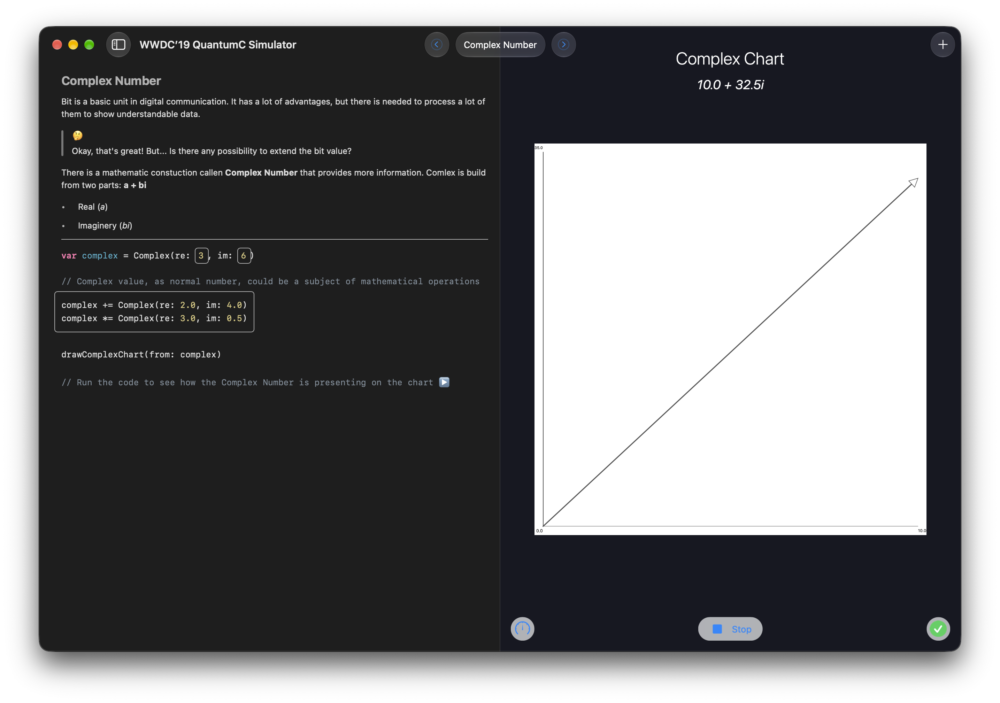
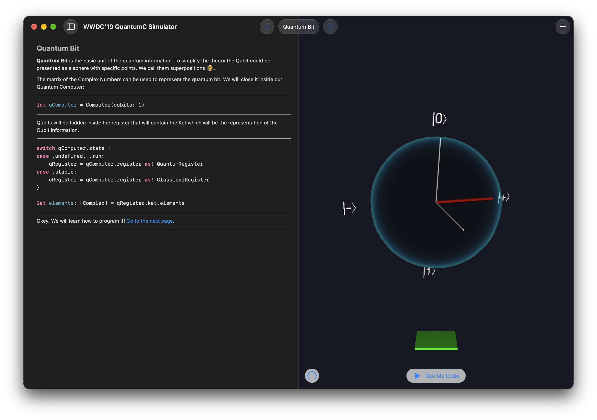
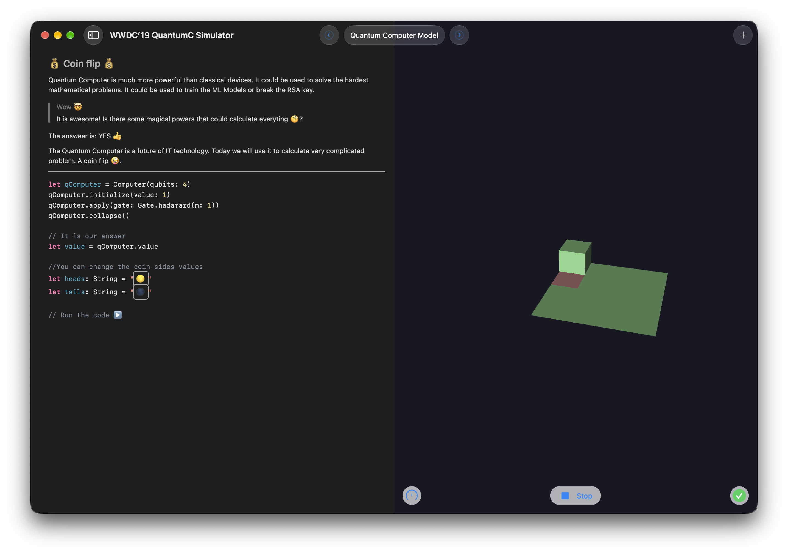
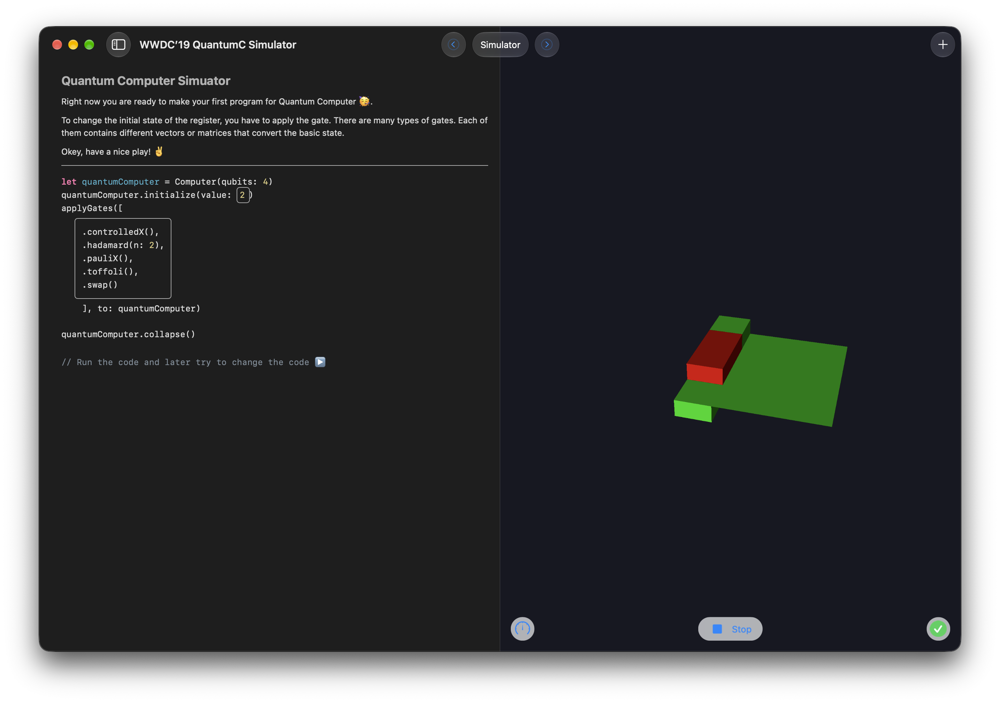

# WWDC19 — QuantumC Simulator

> My **WWDC 2019 Scholarship** winning submission: a Swift Playground Book that teaches how a quantum computer differs from a classical one — by letting you program a small simulator.

The book walks from bits to qubits in five interactive pages:

1. **Classical Computer** — build an 8-bit machine, set its state, apply arithmetic operators and watch the bits change.
2. **Complex Number** — add and multiply complex numbers and see them plotted on a chart.
3. **Quantum Bit** — a qubit as a vector of complex numbers (a `Ket`) held in a quantum register.
4. **Quantum Computer Model** — flip a coin with 4 qubits: put a qubit into superposition with a Hadamard gate, then collapse it.
5. **Simulator** — a sandbox where you chain gates (Hadamard, Pauli X/Y/Z, phase shift, swap, √swap, CNOT, controlled-X/Y/Z, Toffoli, Deutsch) on a 4-qubit register and observe the resulting state.

## Demo

▶ [Watch the demo on YouTube](https://www.youtube.com/watch?v=V48LRbOqf3k)

## Screenshots

<table>
  <tr>
    <td><b>1 · Classical Computer</b> 
      </td>
    <td><b>2 · Complex Number</b> 
      </td>
  </tr>
  <tr>
    <td><b>3 · Quantum Bit</b> 
      </td>
    <td><b>4 · Quantum Computer Model</b> 
      </td>
  </tr>
  <tr>
    <td><b>5 · Simulator</b> 
      </td>
  </tr>
</table>

## What's inside

The simulation is written from scratch (no linear-algebra libraries):

- `Complex`, `Matrix`, `Ket` — the math
- `Gate`, `Operator` — quantum gates as matrices, classical operators
- `Register`, `Computer` — classical and quantum registers behind one interface
- UIKit and SceneKit views — bit view, complex chart, 3D qubit visualisation

## Run it

Open `WWDC’19 QuantumC Simulator.playgroundbook` in **Swift Playgrounds on iPad** (AirDrop or the Files app) and start with the first page.

Built for Swift Playgrounds 2.2+ (Swift 4.2, iOS 11). Newer versions of the app may no longer open the legacy `.playgroundbook` format.
